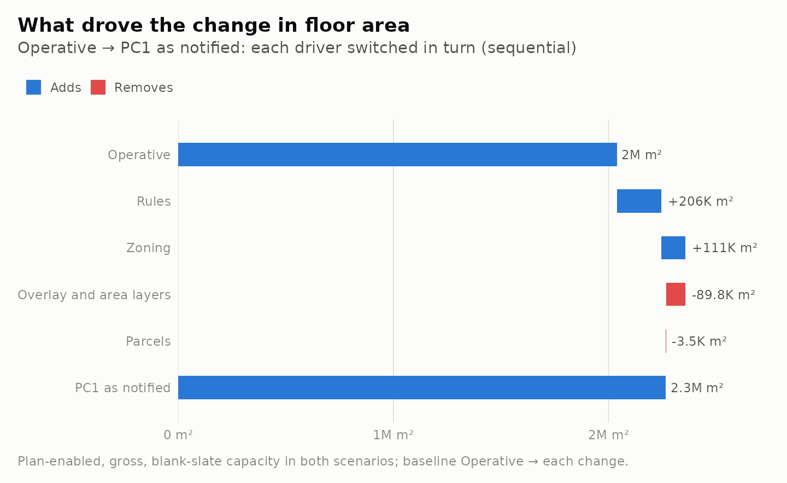
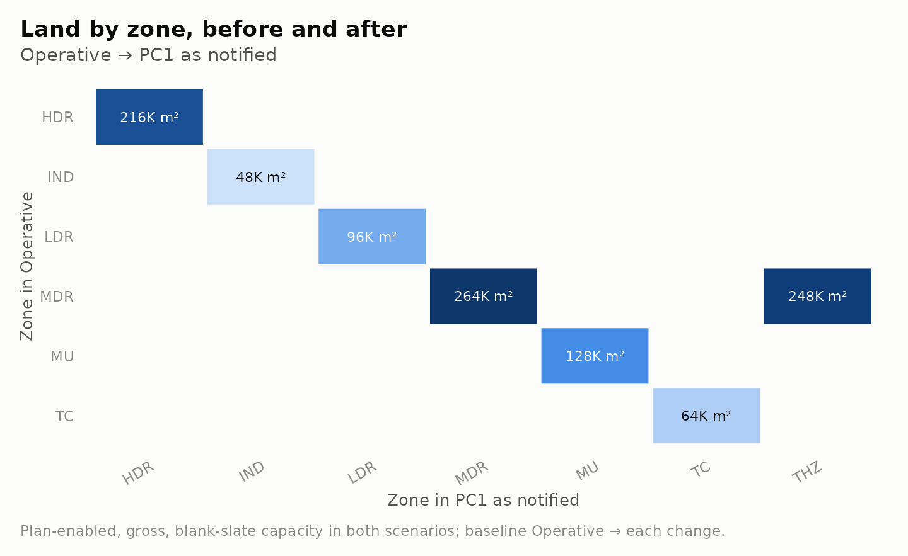
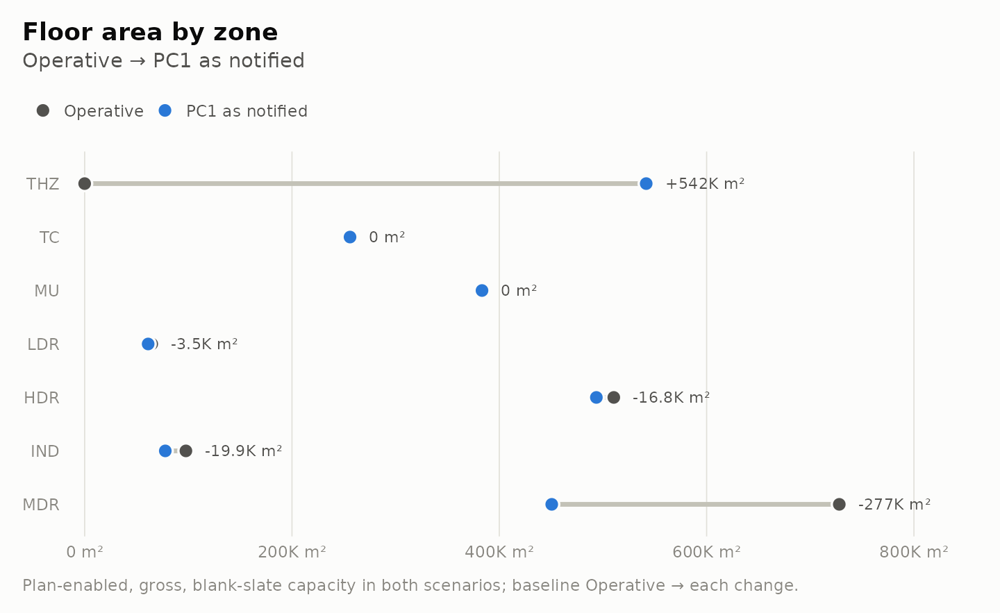
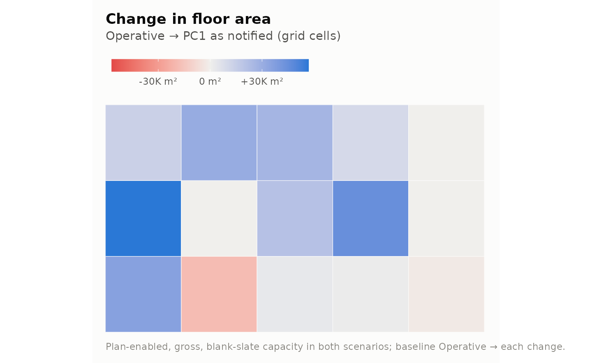

# Comparing plan changes

A plan change rarely moves one thing. Exampleton’s Plan Change 1 raises
a height limit, creates a zone, rezones the blocks near the station,
maps a wider flood plain and re-subdivides a block, all at once. This
vignette compares it with the operative plan: what changed, where, and
why.

``` r

library(plancap)
#> 
#> Attaching package: 'plancap'
#> The following object is masked from 'package:stats':
#> 
#>     density
```

## Two scenarios

A **scenario** is everything that determines capacity. A plan change is
written as a change from the baseline, naming only what differs:

``` r

town <- exampleton()
pc1 <- exampleton_pc1()
base <- scenario("Operative", rulebook_example("exampleton"),
                 parcels = town$parcels[town$parcels$parcel_type == "land", ],
                 roads = town$parcels[town$parcels$parcel_type == "road", ],
                 zoning = town$zoning,
                 layers = town[c("height_areas", "flood_hazard", "heritage", "trees",
                                 "precincts", "transit")],
                 water = town$water, centrelines = town$road_centrelines)
change <- scenario_change(base, "PC1 as notified",
                          rulebook = pc1$rulebook,
                          zoning = pc1$zoning,
                          layers = list(flood_hazard = pc1$flood_hazard),
                          parcels = pc1$parcels[pc1$parcels$parcel_type == "land", ])
set <- scenario_set(base, change)
set
#> <plancap scenario set> 2 scenarios; baseline "Operative".
#> PC1 as notified: rulebook, parcels, zoning, layers differ
```

The PC1 rulebook is a file that `extends:` the operative one and states
only its changes:

    extends: exampleton.yaml

    plan:
      id: exampleton-pc1-2026
      name: "Exampleton District Plan, Plan Change 1 (as notified)"
      effective_date: "2026-09-01"
      source: "Exampleton Plan Change 1 (fictional), notified 1 September 2026"

    zone_map:
      THZ: THZ

    zone_families:
      RESIDENTIAL: [LDR, MDR, THZ, HDR]

    zones:
      MDR:
        height: {value: 16, occupiable: 15, roof_allowance: 1, storeys: 4,
                 source: "PC1 MDR-S1: 15 m, plus 1 m for a pitched roof"}

      THZ:
        label: Terraced Housing
        method: volumetric
        height: {value: 14, occupiable: 13, roof_allowance: 1, storeys: 4,
                 source: "PC1 THZ-S1: 13 m, plus 1 m for a pitched roof"}
        setbacks:
          - {kind: yard, distance: 1.5, boundaries: [road], source: "PC1 THZ-S3"}
          - {kind: yard, distance: 20, boundaries: [riparian], source: "EDP NATC-S1"}
          - {kind: plane, angle_deg: 60, start_height: 6, boundaries: [side, rear],
             when: {beyond_frontage: 20}, source: "PC1 THZ-S2: beyond 20 m of the road"}
        ratios:
          coverage_max: {value: 0.6, source: "PC1 THZ-S4"}
          landscaping_min: {value: 0.15, source: "PC1 THZ-S5"}
        density: {min_dwelling_size: 35, source: "PC1 THZ-S8"}
        use: {residential: true, business: false, residential_share: 1}
        source: "PC1 Chapter THZ"

The same set can be written as a manifest file and read with
[`read_scenarios()`](https://faceteconomics.github.io/plancap/reference/read_scenarios.md);
the one for this example ships with the package:

``` r

identical(names(read_scenarios(system.file("extdata", "exampleton_pc1_scenarios.yaml",
                                           package = "plancap"))),
          c("Operative", "PC1 as notified"))
#> [1] TRUE
```

## What changed in the inputs

``` r

diff_inputs(base, change)
#> <plancap input diff> inputs that differ: rulebook, parcels, zoning, layers.
#> 12 rule changes:
#>  scope  id                      rule applies_to                         from
#>   zone MDR                    height       <NA> 12; occupiable 11; 3 storeys
#>   zone THZ                    method       <NA>                         <NA>
#>   zone THZ                    height       <NA>                         <NA>
#>   zone THZ              setback:yard       road                         <NA>
#>   zone THZ              setback:yard   riparian                         <NA>
#>   zone THZ             setback:plane side, rear                         <NA>
#>   zone THZ              coverage_max       <NA>                         <NA>
#>   zone THZ           landscaping_min       <NA>                         <NA>
#>   zone THZ density.min_dwelling_size       <NA>                         <NA>
#>   zone THZ           use.residential       <NA>                         <NA>
#>   zone THZ              use.business       <NA>                         <NA>
#>   zone THZ     use.residential_share       <NA>                         <NA>
#>                            to  change
#>  16; occupiable 15; 4 storeys changed
#>                    volumetric   added
#>  14; occupiable 13; 4 storeys   added
#>                         1.5 m   added
#>                          20 m   added
#>               60 deg from 6 m   added
#>                           0.6   added
#>                          0.15   added
#>                            35   added
#>                          TRUE   added
#>                         FALSE   added
#>                             1   added
#> Land rezoned:
#>  from  to    area
#>   MDR THZ 248,500
#> Layers changed:
#>         layer  change   area
#>  flood_hazard   added 41,414
#>  flood_hazard removed      0
#> Parcels: 19 only in the baseline, 26 only in the scenario.
```

## Running and comparing

[`run_scenarios()`](https://faceteconomics.github.io/plancap/reference/scenario_set.md)
runs the baseline in full and the change incrementally: only sites whose
inputs differ are rebuilt.

``` r

res <- run_scenarios(set)
#> Operative: 3.8 s.
#> PC1 as notified: 3.7 s, 154 sites copied from the baseline.
cmp <- compare_scenarios(res)
cmp
#> <plancap comparison> baseline "Operative"
#>         scenario sites land_area floor_area residential_floor_area dwellings
#>        Operative 1,379 1,064,000  2,040,100              1,635,826    16,345
#>  PC1 as notified 1,386 1,064,000  2,264,277              1,879,889    19,041
#> 
#> ── PC1 as notified against Operative 
#> floor_area: 2,040,100 to 2,264,277 (+224,177, +11.0%)
#> residential_floor_area: 1,635,826 to 1,879,889 (+244,063, +14.9%)
#> dwellings: 16,345 to 19,041 (+2,696, +16.5%)
#> Drivers of the floor area change: rules +206,042, zoning +111,360, layers
#> -89,764, parcels -3,461.
#> Sites: neighbour_effect 26, overlay_added 4, parcel_changed 19, rezoned 337,
#> rule_changed 373, unchanged 618.
```

## Why: the drivers

The change is split into its drivers by running intermediate scenarios
that switch one driver at a time, in order (rules, then zoning, then
overlay layers, then parcels). The drivers add exactly to the total
change, and the rules driver splits further by the zones and overlays
whose rules changed:

``` r

p <- cmp$pairs[[1]]
p$attribution
#>    driver floor_area residential_floor_area dwellings
#> 1   rules 206042.085             206042.085      2215
#> 2  zoning 111359.786             111359.786      1198
#> 3  layers -89763.823             -69878.053      -727
#> 4 parcels  -3461.114              -3461.114        10
p$rule_attribution
#>            rule  change floor_area residential_floor_area dwellings
#> 1      zone_map changed        0.0                    0.0         0
#> 2 zone_families changed        0.0                    0.0         0
#> 3     zones.MDR changed   206042.1               206042.1      2215
#> 4     zones.THZ   added        0.0                    0.0         0
plot_attribution(cmp)
```



Here PC1’s new MDR height adds floor area on every MDR site; the
rezoning to Terraced Housing adds more; the wider flood plain takes some
away; the re-subdivided block changes little. `attribution = "shapley"`
averages over every order instead, at the cost of more runs. (With this
plan change it warns: some orders apply the new zoning before the new
rules, so land is zoned to a zone the old rulebook does not have.)

## Where: zones, sites and areas

Zone transitions show land and capacity moving from each operative zone
to each PC1 zone:

``` r

tr <- p$transitions
tr[tr$land_area > 1 & tr$from != tr$to, c("from", "to", "land_area", "floor_area_change", "dwellings_change")]
#>   from  to land_area floor_area_change dwellings_change
#> 9  MDR THZ    248500          188389.2             2042
plot_transitions(cmp)
```



``` r

plot_comparison(cmp)
```



Every baseline site carries its change and a reason:

``` r

table(p$sites$reason)
#> 
#> neighbour_effect    overlay_added   parcel_changed          rezoned 
#>               26                4               19              337 
#>     rule_changed        unchanged 
#>              373              618
head(sf::st_drop_geometry(p$sites)[p$sites$reason == "rezoned",
                                   c("unit", "zone_baseline", "zone_scenario", "floor_area_change")])
#>      unit zone_baseline zone_scenario floor_area_change
#> 21 P00021           MDR           THZ        -1011.9917
#> 22 P00022           MDR           THZ         -956.4854
#> 23 P00023           MDR           THZ         -919.5151
#> 24 P00024           MDR           THZ         -704.7160
#> 25 P00025           MDR           THZ         -499.1993
#> 26 P00026           MDR           THZ            0.0000
```

Where the parcels changed (the re-subdivided block), the new lots’
capacity is apportioned to the old parcels by area, so the change still
has a place. A common geography (`areas =` or `grid =`) is always
comparable:

``` r

cmp_grid <- compare_scenarios(res, grid = 400, attribution = "none")
g <- cmp_grid$pairs[[1]]$by_grid
g[order(-g$floor_area_change), c("grid", "floor_area_baseline", "floor_area_scenario", "floor_area_change")][1:5, ]
#> Simple feature collection with 5 features and 4 fields
#> Geometry type: POLYGON
#> Dimension:     XY
#> Bounding box:  xmin: 2200000 ymin: 5600000 xmax: 2201600 ymax: 5601200
#> Projected CRS: NZGD2000 / New Zealand Transverse Mercator 2000
#>          grid floor_area_baseline floor_area_scenario floor_area_change
#> 2  5500_14001           154892.58           211754.46          56861.88
#> 11 5503_14001           150611.57           195388.45          44776.88
#> 1  5500_14000           148176.02           184367.95          36191.93
#> 6  5501_14002            51812.44            82745.91          30933.47
#> 9  5502_14002            51126.62            77615.82          26489.21
#>                          geometry
#> 2  POLYGON ((2200000 5600400, ...
#> 11 POLYGON ((2201200 5600400, ...
#> 1  POLYGON ((2200000 5600000, ...
#> 6  POLYGON ((2200400 5600800, ...
#> 9  POLYGON ((2200800 5600800, ...
plot_change_map(cmp_grid, on = "grid")
```



## Checking it adds up

``` r

check_comparison(cmp)
#> ✔ Operative -> PC1 as notified: drivers sum to the change in floor_area: 224176.93 of 224176.93
#> ✔ Operative -> PC1 as notified: transitions reproduce floor_area:
#> ✔ Operative -> PC1 as notified: zones reproduce floor_area:
#> ✔ Operative -> PC1 as notified: height bands reproduce floor_area:
#> ✔ Operative -> PC1 as notified: sites reproduce floor_area: 2264277.34 of 2264277.34
#> ✔ Operative -> PC1 as notified: drivers sum to the change in dwellings: 2696.00 of 2696.00
#> ✔ Operative -> PC1 as notified: transitions reproduce dwellings:
#> ✔ Operative -> PC1 as notified: zones reproduce dwellings:
#> ✔ Operative -> PC1 as notified: height bands reproduce dwellings:
#> ✔ Operative -> PC1 as notified: sites reproduce dwellings: 19041.00 of 19041.00
#> ✔ Operative -> PC1 as notified: land reconciles: 1064000 to 1064000 m2 (0 only in the baseline, 0 only in the scenario)
```
