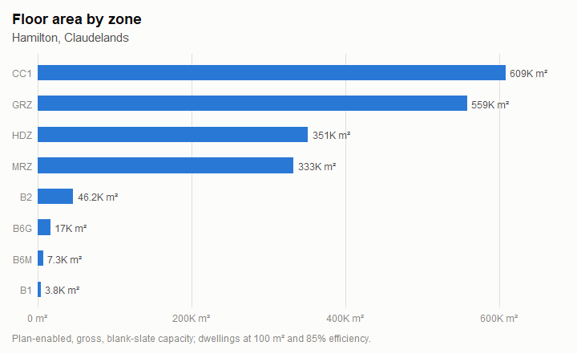
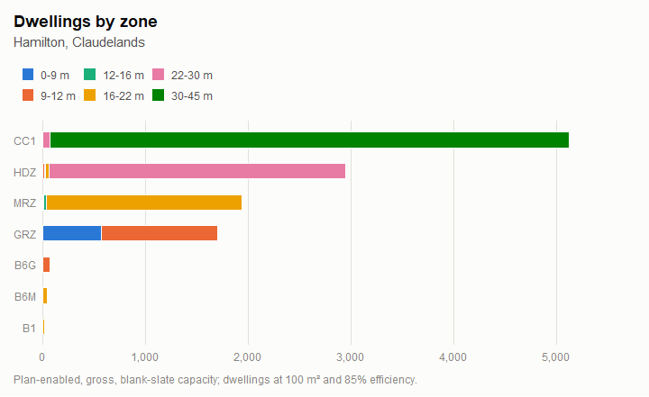
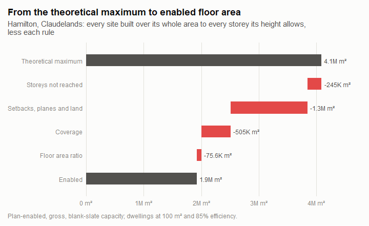
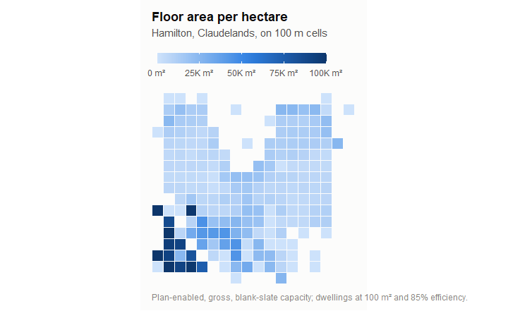
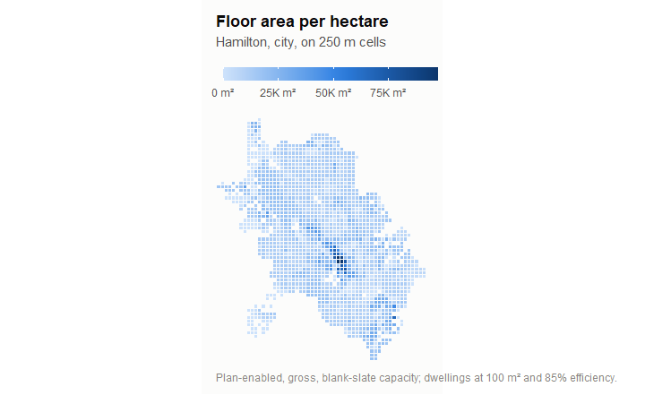

# Adding a new jurisdiction: Hamilton

This vignette adds a real jurisdiction from nothing: Hamilton, New
Zealand. It follows the route a planner or analyst would take with a
plan they have not modelled before: read the plan, enter its rules in
the Excel template, prepare the parcels and the zoning, run capacity,
check it, and ask a question of it. The walkthrough was first done on 23
November 2026 for one area and five zones; the rulebook was then built
out to the whole plan (25 November 2026), and the last section runs it
over the whole city.

## 1. Read the plan

Hamilton’s rules are in the **Hamilton City Operative District Plan**,
read in its online ePlan at the revision of 13 November 2026. Plan
Change 12 (Enabling Housing Supply), Hamilton’s response to the National
Policy Statement on Urban Development, was made operative on 20 December
2024 and is part of that text. The walkthrough starts with the zones of
one area, Claudelands and Hamilton East: General, Medium Density and
High Density Residential (Chapter 4), and the Business 6 (neighbourhood
centre) and Business 2 zones (Chapter 6). The finished rulebook adds the
rest in three stages:

- **residential**: Large Lot Residential, Peacocke’s Medium Density zone
  (Chapter 4A), the residential precincts, the Three Waters
  Infrastructure Capacity Overlay’s density, the riverbank and gully
  hazard setback and the 5 m setback from arterial roads;
- **centres and business**: Business 1 to 7, the Peacocke centres, the
  Central City precincts, the Knowledge, Industrial, Ruakura and Te Rapa
  North zones;
- **overlays**: built heritage, Historic Heritage Areas, Significant
  Natural Areas, and the High Flood Hazard Area of Plan Change 14
  (Flooding).

For each zone, the rules that shape a building or count its dwellings
were written down with their rule numbers (the notes are in
`data-raw/hamilton/rules_notes.md` in the package source). In summary:

|  | General Residential | Medium Density Residential | High Density Residential | Business 6 |
|----|----|----|----|----|
| Height | 10 m (4.2.5.4) | 18 m, 5 storeys (4.3.4.4) | 26 m (4.4.5.4) | 11 m next to General Residential, 18 m next to Medium Density (6.4.1) |
| Recession plane | 45° from 4 m, not to a road (4.2.5.5) | one or two units: 60° from 4 m, 45° to General Residential; three or more attached units: no plane on side boundaries within 20 m of the road, 60° from 6 m beyond (4.3.4.5) | only to other zones: 45° to General Residential, 60° from 6 m to Medium Density beyond 20 m (4.4.5.5) | 45° from 4 m to General Residential, 60° to Medium Density (6.4.2) |
| Setbacks | road 1.5 m, side and rear 1.5 m (4.2.5.6) | road 1.5 m, side and rear 1 m (4.3.4.6) | 1 m; parts over 11 m 4 m back (4.4.5.6, 4.4.5.14) | 0 m front; 1.5 m to a residential zone (6.4.3) |
| Coverage | 45% (4.2.5.2) | 50% (4.3.4.2) | 60% (4.4.5.2) | floor area ratio 2:1 or 3:1 (6.4.4) |
| Landscaping | 20% (4.2.5.3) | 20% (4.3.4.3) | 10% (4.4.5.3) | none at ground floor dwellings: none allowed (6.4.7) |
| Dwellings | two per site permitted, more restricted discretionary (4.2.3.1) | three per site permitted, more restricted discretionary (4.3.3.1) | three or more restricted discretionary (4.4.3.1) | above ground floor only (6.3, 6.4.7) |

Some rules need more than zoning. The 5 m setback from arterial roads
needs the road hierarchy: the council’s road centre lines carry a class,
and the rulebook names the column (`morphology: road_class_field`), so
each road boundary is tagged with the class of the road in front and a
setback can name `minor_arterial_road`. The density rule applies only
inside an infrastructure overlay, and the hazard setback only near a
gully: both are overlays with their own layers. Rules that cannot be
applied are not dropped: they go in the rulebook’s register of rules not
modelled, with the direction each would move capacity.

Two choices in the full rulebook are assumptions, not rules, and the
rulebook says so: the Central City has no maximum height, so 32 m (above
which new buildings take added design matters) is used; and industrial
zones use a 7 m storey rather than the 3 m default. Plan Change 14
(Flooding) was decided on 24 December 2025 and is under appeal; its High
Flood Hazard Area is applied as though in force, marked as proposed.

The plan’s definitions matter too. Hamilton’s density rules are “average
net site area” per unit, and net site area leaves out any entrance strip
or private way; its floor area ratio is also over the net area of the
site. By default plancap measures both on the whole site, as
capacityengine does, so the rulebook says otherwise
(`morphology: density_area: net`, `far_area: net`). On a rear site the
access leg then gives no dwellings.

## 2. Enter the rules in the template

[`rulebook_template()`](https://faceteconomics.github.io/plancap/reference/rulebook_template.md)
writes an empty workbook with one sheet per kind of rule and a `fields`
sheet explaining every column. The rules above were typed into it, a row
per zone, a row per setback, each with its citation:

``` r

f <- system.file("extdata", "hamilton_rulebook.xlsx", package = "plancap")
if (!nzchar(f)) f <- "../inst/extdata/hamilton_rulebook.xlsx"
z <- openxlsx2::read_xlsx(f, sheet = "zones")
z[z$method != "none", c("zone", "codes", "height", "storeys", "coverage_max", "landscaping_min", "far_max", "height_source")]
#>    zone                                   codes height storeys coverage_max
#> 2   GRZ                     General Residential     10      NA         0.45
#> 3   MRZ              Medium Density Residential     18       5         0.50
#> 4   HDZ                High Density Residential     26      NA         0.60
#> 5  LLRZ                   Large Lot Residential     10      NA         0.20
#> 6  PMRZ     Peacocke Medium Density Residential     12       3         0.60
#> 7   B6G        Business 6 (General Residential)     11      NA           NA
#> 8   B6M Business 6 (Medium Density Residential)     18      NA           NA
#> 9    B2                              Business 2     16      NA           NA
#> 10   B1                              Business 1     16      NA           NA
#> 11   B3                              Business 3     20      NA           NA
#> 12   B4                              Business 4     16      NA           NA
#> 13  B4I                 Business 4 (Industrial)     20      NA           NA
#> 14   B5                              Business 5     26      NA           NA
#> 15   B7                              Business 7     16      NA           NA
#> 16 PNCZ           Peacocke Neighbourhood Centre     16      NA           NA
#> 17 PLCZ                   Peacocke Local Centre     24      NA           NA
#> 18  CC1                   Central City Downtown     32      NA         1.00
#> 19  CC2                Central City City Living     32      NA         0.70
#> 20  CC3                  Central City Ferrybank     32      NA         0.80
#> 21  KNZ                               Knowledge     15      NA         0.50
#> 22  IND                              Industrial     20      NA           NA
#> 23  RLZ                       Ruakura Logistics     20      NA         0.80
#> 24 RIPZ                 Ruakura Industrial Park     20      NA         0.75
#> 25 TRNZ                Te Rapa North Industrial     20      NA           NA
#>    landscaping_min far_max
#> 2              0.2      NA
#> 3              0.2      NA
#> 4              0.1      NA
#> 5              0.7      NA
#> 6              0.2      NA
#> 7               NA       2
#> 8               NA       3
#> 9               NA       2
#> 10              NA       2
#> 11              NA       2
#> 12              NA       2
#> 13              NA       2
#> 14              NA       4
#> 15              NA       2
#> 16              NA      NA
#> 17              NA      NA
#> 18              NA      NA
#> 19             0.2      NA
#> 20             0.2      NA
#> 21             0.2      NA
#> 22             0.1      NA
#> 23             0.1      NA
#> 24             0.2      NA
#> 25             0.2      NA
#>                                                                                                                       height_source
#> 2                                                                                                                   HCC ODP 4.2.5.4
#> 3                                                                                                                 HCC ODP 4.3.4.4 a
#> 4                                                                                                                   HCC ODP 4.4.5.4
#> 5                                                                                                                   HCC ODP 4.5.4.4
#> 6                                                                                     HCC ODP 4A MRZ-PREC1-PSP R37: 12 m, 3 storeys
#> 7                                                                                                                     HCC ODP 6.4.1
#> 8                                                                                                                     HCC ODP 6.4.1
#> 9                                                                                                                     HCC ODP 6.4.1
#> 10                                                                                                                    HCC ODP 6.4.1
#> 11                                                                                                                    HCC ODP 6.4.1
#> 12                                                                                                                    HCC ODP 6.4.1
#> 13                                                                          HCC ODP 6.4.1: 20 m where adjoining the Industrial Zone
#> 14                                                                                                                    HCC ODP 6.4.1
#> 15                                                                                                                    HCC ODP 6.4.1
#> 16                                                                                                     HCC ODP 6A NCZ-PREC1-PSP R46
#> 17                                        HCC ODP 6B LCZ-PREC1-PSP R40: 24 m (16 m within 30 m of a Residential or Open Space Zone)
#> 18 Assumption: Chapter 7 sets no maximum height; 32 m is the height above which new buildings (RD*) take added design matters (7.3)
#> 19                                                  Assumption: no maximum height in Chapter 7; 32 m (7.3 design matters threshold)
#> 20                                                  Assumption: no maximum height in Chapter 7; 32 m (7.3 design matters threshold)
#> 21                                                                          HCC ODP 8.4.8: 15 m (20% of a footprint may reach 20 m)
#> 22                                                                                                                    HCC ODP 9.4.2
#> 23                                                                                                                   HCC ODP 10.4.5
#> 24                                                                                                                   HCC ODP 11.4.4
#> 25                                                                                  HCC ODP 12.4.2 (Stage 1A exceptions unmodelled)
s <- openxlsx2::read_xlsx(f, sheet = "setbacks")
s[s$target == "MRZ", c("target", "kind", "boundaries", "distance", "angle_deg", "start_height", "above_height",
                       "within_frontage", "beyond_frontage", "adjacent_zones", "not_adjacent_zones", "variant")]
#>    target        kind                                              boundaries
#> 6     MRZ        yard                                                    road
#> 7     MRZ        yard                                                    side
#> 8     MRZ        yard                                                    rear
#> 9     MRZ       plane                                              side, rear
#> 10    MRZ       plane                                              side, rear
#> 11    MRZ upper_level                                                    side
#> 12    MRZ       plane                                              side, rear
#> 13    MRZ       plane                                              side, rear
#> 15    MRZ        yard state_highway, major_arterial_road, minor_arterial_road
#>    distance angle_deg start_height above_height within_frontage beyond_frontage
#> 6       1.5        NA           NA           NA              NA              NA
#> 7       1.0        NA           NA           NA              NA              NA
#> 8       1.0        NA           NA           NA              NA              NA
#> 9        NA        60            4           NA              NA              NA
#> 10       NA        45            4           NA              NA              NA
#> 11      4.0        NA           NA           11              20              NA
#> 12       NA        60            6           NA              NA              20
#> 13       NA        45            4           NA              NA              NA
#> 15      5.0        NA           NA           NA              NA              NA
#>    adjacent_zones not_adjacent_zones       variant
#> 6            <NA>               <NA>          <NA>
#> 7            <NA>               <NA>          <NA>
#> 8            <NA>               <NA>          <NA>
#> 9            <NA>                GRZ single_duplex
#> 10            GRZ               <NA> single_duplex
#> 11           <NA>                GRZ      attached
#> 12           <NA>                GRZ      attached
#> 13            GRZ               <NA>      attached
#> 15           <NA>               <NA>          <NA>
```

Medium Density’s two sets of standards (one or two units; three or more
attached) are entered as two **variants**: each site is built under both
and takes the one that enables more. Business 6’s residential share is a
band by storey, none on the ground floor:

``` r

openxlsx2::read_xlsx(f, sheet = "bands")
#>    target              rule     by upper value
#> 2     B6G residential_share storey     1     0
#> 3     B6G residential_share storey    NA     1
#> 4     B6M residential_share storey     1     0
#> 5     B6M residential_share storey    NA     1
#> 6      B1 residential_share storey     1     0
#> 7      B1 residential_share storey    NA     1
#> 8      B3 residential_share storey     1     0
#> 9      B3 residential_share storey    NA     1
#> 10     B5 residential_share storey     1     0
#> 11     B5 residential_share storey    NA     1
#> 12   PNCZ residential_share storey     1     0
#> 13   PNCZ residential_share storey    NA     1
#> 14   PLCZ residential_share storey     1     0
#> 15   PLCZ residential_share storey    NA     1
#>                                                                      source
#> 2  HCC ODP 6.4.7 b, 6A R51, 6B R45: no residential activity at ground floor
#> 3                                                                      <NA>
#> 4  HCC ODP 6.4.7 b, 6A R51, 6B R45: no residential activity at ground floor
#> 5                                                                      <NA>
#> 6  HCC ODP 6.4.7 b, 6A R51, 6B R45: no residential activity at ground floor
#> 7                                                                      <NA>
#> 8  HCC ODP 6.4.7 b, 6A R51, 6B R45: no residential activity at ground floor
#> 9                                                                      <NA>
#> 10 HCC ODP 6.4.7 b, 6A R51, 6B R45: no residential activity at ground floor
#> 11                                                                     <NA>
#> 12 HCC ODP 6.4.7 b, 6A R51, 6B R45: no residential activity at ground floor
#> 13                                                                     <NA>
#> 14 HCC ODP 6.4.7 b, 6A R51, 6B R45: no residential activity at ground floor
#> 15                                                                     <NA>
```

The workbook reads back as a rulebook, checked against the schema and
for missing citations:

``` r

rb <- read_rulebook(f)
rb
#> <plancap rulebook> Hamilton City Operative District Plan
#> hamilton-odp-2026 | Hamilton | NZ | as at 2026-11-13
#> 32 zones, 9 overlays, 1 area, 0 bonuses, 0 entitlements; 22 unmodelled rules.
#> Units: metres.
#>  zone label                                                           
#>  GRZ  General Residential Zone                                        
#>  MRZ  Medium Density Residential Zone                                 
#>  HDZ  High Density Residential Zone                                   
#>  LLRZ Large Lot Residential Zone                                      
#>  PMRZ Medium Density Residential Zone, Peacocke Precinct              
#>  B6G  Business 6 Zone, adjacent to the General Residential Zone       
#>  B6M  Business 6 Zone, adjacent to the Medium Density Residential Zone
#>  B2   Business 2 Zone (Events Facilities Fringe)                      
#>  B1   Business 1 Zone (Commercial Fringe)                             
#>  B3   Business 3 Zone (Sub-Regional Centre)                           
#>  B4   Business 4 Zone (Large Format Retail)                           
#>  B4I  Business 4 Zone, adjoining the Industrial Zone                  
#>  B5   Business 5 Zone (Suburban Centre)                               
#>  B7   Business 7 Zone (Frankton Commercial Fringe)                    
#>  PNCZ Neighbourhood Centre Zone, Peacocke Precinct                    
#>  PLCZ Local Centre Zone, Peacocke Precinct                            
#>  CC1  Central City Zone, Precinct 1 (Downtown)                        
#>  CC2  Central City Zone, Precinct 2 (City Living)                     
#>  CC3  Central City Zone, Precinct 3 (Ferrybank)                       
#>  KNZ  Knowledge Zone                                                  
#>  IND  Industrial Zone                                                 
#>  RLZ  Ruakura Logistics Zone                                          
#>  RIPZ Ruakura Industrial Park Zone                                    
#>  TRNZ Te Rapa North Industrial Zone                                   
#>  CFZ  Community Facilities Zone                                       
#>  MFZ  Major Facilities Zone                                           
#>  OSZ  Open Space Zones                                                
#>  KNU  Knowledge Zone, University of Waikato Campus (concept plan)     
#>  TRND Te Rapa North Industrial Zone, Deferred                         
#>  RTC  Rototuna Town Centre Zone (development plans)                   
#>  FUZ  Future Urban Zone                                               
#>  TCZ  Transport Corridor Zone                                         
#>  method     height setbacks coverage codes                                  
#>  volumetric 10     5        0.45     General Residential                    
#>  volumetric 18     9        0.5      Medium Density Residential             
#>  volumetric 26     8        0.6      High Density Residential               
#>  hybrid     10     5        0.2      Large Lot Residential                  
#>  volumetric 12     4        0.6      Peacocke Medium Density Residential    
#>  volumetric 11     4                 Business 6 (General Residential)       
#>  volumetric 18     4                 Business 6 (Medium Density Residential)
#>  volumetric 16     4                 Business 2                             
#>  volumetric 16     4                 Business 1                             
#>  volumetric 20     3                 Business 3                             
#>  volumetric 16     4                 Business 4                             
#>  volumetric 20     4                 Business 4 (Industrial)                
#>  volumetric 26     4                 Business 5                             
#>  volumetric 16     4                 Business 7                             
#>  volumetric 16     3                 Peacocke Neighbourhood Centre          
#>  volumetric 24     4                 Peacocke Local Centre                  
#>  volumetric 32     2        1        Central City Downtown                  
#>  volumetric 32     4        0.7      Central City City Living               
#>  volumetric 32     5        0.8      Central City Ferrybank                 
#>  volumetric 15     4        0.5      Knowledge                              
#>  volumetric 20     6                 Industrial                             
#>  volumetric 20     1        0.8      Ruakura Logistics                      
#>  volumetric 20     5        0.75     Ruakura Industrial Park                
#>  volumetric 20     4                 Te Rapa North Industrial               
#>  none              0                 Community Facilities                   
#>  none              0                 Major Facilities                       
#>  none              0                 Open Space                             
#>  none              0                 Knowledge University                   
#>  none              0                 Te Rapa North Deferred                 
#>  none              0                 Rototuna Town Centre                   
#>  none              0                 Future Urban                           
#>  none              0                 Transport Corridor
validate_rulebook(rb)
#> ✔ Rulebook is valid (0 warnings, 17 notes).
#> ℹ /zones/GRZ/setbacks/4: boundary class not built in: state_highway,
#>   major_arterial_road, minor_arterial_road (a road class tagged from the centre
#>   lines?)
#> ℹ /zones/MRZ/setbacks/8: boundary class not built in: state_highway,
#>   major_arterial_road, minor_arterial_road (a road class tagged from the centre
#>   lines?)
#> ℹ /zones/HDZ/setbacks/0: boundary class not built in: state_highway,
#>   major_arterial_road, minor_arterial_road (a road class tagged from the centre
#>   lines?)
#> ℹ /zones/B6G/setbacks/0: boundary class not built in: state_highway,
#>   major_arterial_road, minor_arterial_road (a road class tagged from the centre
#>   lines?)
#> ℹ /zones/B6M/setbacks/0: boundary class not built in: state_highway,
#>   major_arterial_road, minor_arterial_road (a road class tagged from the centre
#>   lines?)
#> ℹ /zones/B2/setbacks/0: boundary class not built in: state_highway,
#>   major_arterial_road, minor_arterial_road (a road class tagged from the centre
#>   lines?)
#> ℹ /zones/B1/setbacks/0: boundary class not built in: state_highway,
#>   major_arterial_road, minor_arterial_road (a road class tagged from the centre
#>   lines?)
#> ℹ /zones/B3/setbacks/0: boundary class not built in: state_highway,
#>   major_arterial_road, minor_arterial_road (a road class tagged from the centre
#>   lines?)
#> ℹ /zones/B4/setbacks/0: boundary class not built in: state_highway,
#>   major_arterial_road, minor_arterial_road (a road class tagged from the centre
#>   lines?)
#> ℹ /zones/B4I/setbacks/0: boundary class not built in: state_highway,
#>   major_arterial_road, minor_arterial_road (a road class tagged from the centre
#>   lines?)
#> ℹ /zones/B5/setbacks/0: boundary class not built in: state_highway,
#>   major_arterial_road, minor_arterial_road (a road class tagged from the centre
#>   lines?)
#> ℹ /zones/B7/setbacks/0: boundary class not built in: state_highway,
#>   major_arterial_road, minor_arterial_road (a road class tagged from the centre
#>   lines?)
#> ℹ /zones/KNZ/setbacks/1: boundary class not built in: state_highway,
#>   major_arterial_road, minor_arterial_road (a road class tagged from the centre
#>   lines?)
#> ℹ /zones/IND/setbacks/1: boundary class not built in: state_highway,
#>   major_arterial_road, minor_arterial_road (a road class tagged from the centre
#>   lines?)
#> ℹ /zones/IND/setbacks/2: boundary class not built in: state_highway,
#>   major_arterial_road, minor_arterial_road (a road class tagged from the centre
#>   lines?)
#> ℹ /zones/RIPZ/setbacks/1: boundary class not built in: state_highway,
#>   major_arterial_road, minor_arterial_road (a road class tagged from the centre
#>   lines?)
#> ℹ /zones/TRNZ/setbacks/1: boundary class not built in: state_highway,
#>   major_arterial_road, minor_arterial_road (a road class tagged from the centre
#>   lines?)
head(rule_table(rb)[, c("zone", "rule", "value", "applies_to", "source")], 12)
#>    zone                             rule             value
#> 1   GRZ                           method        volumetric
#> 2   GRZ                           height 10; occupiable 10
#> 3   GRZ                     setback:yard             1.5 m
#> 4   GRZ                     setback:yard             1.5 m
#> 5   GRZ                     setback:yard             1.5 m
#> 6   GRZ                    setback:plane   45 deg from 4 m
#> 7   GRZ                     setback:yard               5 m
#> 8   GRZ                     coverage_max              0.45
#> 9   GRZ                  landscaping_min               0.2
#> 10  GRZ                   impervious_max               0.7
#> 11  GRZ density.minor_dwellings_per_site                 1
#> 12  GRZ                  use.residential              TRUE
#>                                                 applies_to
#> 1                                                     <NA>
#> 2                                                     <NA>
#> 3                                                     road
#> 4                                                     side
#> 5                                                     rear
#> 6                                               side, rear
#> 7  state_highway, major_arterial_road, minor_arterial_road
#> 8                                                     <NA>
#> 9                                                     <NA>
#> 10                                                    <NA>
#> 11                                                    <NA>
#> 12                                                    <NA>
#>                                                                source
#> 1                                HCC ODP 4.2 General Residential Zone
#> 2                                                     HCC ODP 4.2.5.4
#> 3          HCC ODP 4.2.5.6 a: local and collector transport corridors
#> 4                                                   HCC ODP 4.2.5.6 b
#> 5                                                   HCC ODP 4.2.5.6 d
#> 6  HCC ODP 4.2.5.5: 45 degrees from 4 m, all boundaries except a road
#> 7                     HCC ODP 4.2.5.6 a: arterial transport corridors
#> 8                                                     HCC ODP 4.2.5.2
#> 9                                                   HCC ODP 4.2.5.3 b
#> 10                                                  HCC ODP 4.2.5.3 a
#> 11 HCC ODP 4.2.3.1, 4.2.6.1: ancillary residential unit, one per site
#> 12                                                    HCC ODP 4.2.3.1
```

## 3. Prepare the parcels and zoning

Two layers come from their publishers, cut to a square of about 1.4 km
over Claudelands and Hamilton East:

- **parcels**: LINZ NZ Primary Parcels (CC BY 4.0), split into land
  parcels and road parcels;
- **zoning**: Hamilton City Council’s District Plan Zones. The council
  asks that its data be attributed to it and that derived work say it is
  not the authoritative source: this is derived work, not Hamilton City
  Council’s data. The zoning is not shipped with the package.

Overlay layers come from the council’s map services: the infrastructure
overlay and precincts (Plan Change 12), the gully hazard area,
Peacocke’s height overlay, heritage and natural areas (Plan Change 9),
the flood hazard model, and the road hierarchy.

The zoning layer needs four changes before plancap can use it, which is
typical of a council layer (`data-raw/hamilton/prepare.R`):

1.  Zone names become the codes the rulebook’s zone map expects (`codes`
    in the zones sheet).
2.  Business 6’s height and floor area ratio depend on the residential
    zone it adjoins, so each centre polygon is coded by its neighbour.
3.  Two features are not zones: the Industrial Amenity Protection Area
    (an overlay stored with the zones, used as one) and the Transport
    Corridor Zone.
4.  Some polygons overlap by slivers; each overlap is given to one zone.

The third was found the useful way. The first run left the Transport
Corridor Zone in, and
[`check_capacity()`](https://faceteconomics.github.io/plancap/reference/check_capacity.md)
failed its land check: the sites added to twice the land in the parcels.
That zone is a single polygon under every other zone, so it split nearly
every parcel in two. Roads come from the road parcels, so the polygon is
dropped.

``` r

source("../data-raw/hamilton/prepare.R")
h <- hamilton_inputs("../data-raw/cache/hamilton")
table(h$zoning$zone)
#> 
#>                              Business 1                              Business 2 
#>                                       1                                       2 
#>        Business 6 (General Residential) Business 6 (Medium Density Residential) 
#>                                       2                                       2 
#>                   Central City Downtown                    Community Facilities 
#>                                       7                                       6 
#>                     General Residential                High Density Residential 
#>                                      50                                       5 
#>                        Major Facilities              Medium Density Residential 
#>                                       1                                      13 
#>                              Open Space 
#>                                      23
nrow(h$parcels)
#> [1] 1474
```

## 4. Run capacity and check it

``` r

names(h$layers)
#> [1] "infrastructure_capacity" "built_heritage"         
#> [3] "heritage_area"           "natural_area"           
#> [5] "flood_high"              "precincts"              
#> [7] "gully_hazard"            "peacocke_height"        
#> [9] "amenity_protection"
sc <- scenario("Hamilton, Claudelands", rb, parcels = h$parcels, roads = h$roads, zoning = h$zoning,
               layers = h$layers, centrelines = h$centrelines)
cap <- estimate_capacity(sc)
summary(cap)
#> 
#> ── Capacity: Hamilton, Claudelands ──
#> 
#> 1,493 sites on 187.5 ha: 1,926,038 m2 of floor area (1,868,430 m2 residential,
#> 57,608 m2 business), 11,848 dwellings and 1,210 minor dwellings.
#> Plan-enabled, gross, blank-slate capacity; dwellings at 100 m2 and 85%
#> efficiency.
#> 
#> ── By zone
#>  zone_key sites land_area floor_area dwellings  far floor_area_share
#>    (none)    11    14,277          0         0 0.00             0.0%
#>        B1     2     1,903      3,805        15 2.00             0.2%
#>        B2    20    23,245     46,233         0 1.99             2.4%
#>       B6G    18    10,256     16,951        74 1.65             0.9%
#>       B6M    12     2,591      7,318        40 2.82             0.4%
#>       CC1   108    70,941    608,683     5,125 8.58            31.6%
#>       CFZ    35   305,192          0         0 0.00             0.0%
#>       GRZ   970   721,053    558,535     1,706 0.77            29.0%
#>       HDZ    91    86,529    351,442     2,950 4.06            18.2%
#>       MFZ     2   163,624          0         0 0.00             0.0%
#>       MRZ   162   160,558    333,069     1,938 2.07            17.3%
#>       OSZ    62   314,655          0         0 0.00             0.0%
#> 
#> ── Flags
#> no_capacity 99, no_capacity_zone 99, no_zone 11, ok 1,284
#> 
#> ── What limits dwellings
#> floor_area 555, max_dwellings_per_site 443, density 385
check_capacity(cap)
#> ✔ parcels accounted for: 1474 of 1474 (every input parcel is in a site)
#> ✔ land in equals land out: 1874825 of 1874825 m2 (site areas add to parcel areas (overlaps aside))
#> ✔ storeys add to sites: 1926038 m2 (floor area by storey equals floor area by site)
#> ✔ uses add to floor area:  (residential plus business equals floor area)
#> ✔ no missing or negative values: 0 (floor area and dwellings)
#> ✔ within the height's storeys: 0 (no site above its area times its storeys)
#> ✔ site ids unique: 0
#> ✔ dwellings need floor area: 0 (volumetric sites with dwellings but no floor area)
#> ✔ access measured: 0 (sites the access width table could not be applied to)
#> ✔ flags: no_capacity 99, no_capacity_zone 99, no_zone 11, ok 1284 (sites by flag)
#> ✔ sites with no capacity: 209 (no_capacity 99, no_capacity_zone 99, no_zone 11)
```

The sites with no zone are land parcels inside the transport corridor
(once the corridor polygon is dropped, nothing zones them). They are
flagged, not dropped.

``` r

plot_capacity(cap)
```



plot of chunk unnamed-chunk-7

``` r

plot_capacity(cap, measure = "dwellings", fill = "height_band")
```



plot of chunk unnamed-chunk-7

``` r

plot_constraints(cap)
```



plot of chunk unnamed-chunk-7

``` r

plot_capacity_map(cap, grid = 100)
```



plot of chunk unnamed-chunk-7

## 5. Look at one site

A Medium Density site near a General Residential boundary shows the
alternative standards at work:

``` r

s <- sf::st_drop_geometry(cap$sites)
pick <- s$site_id[s$zone_key %in% "MRZ" & s$area > 600 & s$area < 900][1]
ex <- explain_site(cap, pick)
ex$site[, c("site_id", "zone_key", "area", "variant", "storeys", "floor_area", "dwellings")]
#>    site_id zone_key     area  variant storeys floor_area dwellings
#> 13 4258598      MRZ 841.9517 attached       5   1562.303         5
ex$setbacks[ex$setbacks$storey == 5, c("segment_id", "boundary_class", "setback", "rule", "source")]
#>    segment_id boundary_class  setback        rule
#> 25  4258598-1           road 5.000000        yard
#> 26  4258598-2           side 6.928203       plane
#> 27  4258598-3           side 4.000000 upper_level
#> 28  4258598-4           side 4.000000 upper_level
#> 29  4258598-5           road 1.500000        yard
#> 30  4258598-6           side 6.928203       plane
#>                                                                                           source
#> 25                                           HCC ODP 4.3.4.6 a iii: arterial transport corridors
#> 26             HCC ODP 4.3.4.5 b, Figure 4.3.4.5 b: beyond 20 m of the road, 60 degrees from 6 m
#> 27 HCC ODP 4.3.4.5 b: within 20 m of the road, parts over 11 m set back 4 m from side boundaries
#> 28 HCC ODP 4.3.4.5 b: within 20 m of the road, parts over 11 m set back 4 m from side boundaries
#> 29                                                                          HCC ODP 4.3.4.6 a ii
#> 30             HCC ODP 4.3.4.5 b, Figure 4.3.4.5 b: beyond 20 m of the road, 60 degrees from 6 m
plot_site(cap, pick, view = "axo")
```


plot of chunk unnamed-chunk-8

## 6. Ask a question: permitted activities only

Capacity here counts restricted discretionary development where the
plan’s standards bound it, as plancap’s Auckland example does. A
narrower reading counts only what is permitted: two units per site in
General Residential and three in Medium Density. That is a rule change,
so it is a scenario:

``` r

permitted <- rb |>
  set_rule("zones.GRZ.density.max_dwellings_per_site", 2) |>
  set_rule("zones.MRZ.density.max_dwellings_per_site", 3)
sc_p <- scenario_change(sc, "Permitted activities only", rulebook = permitted)
cmp <- compare_scenarios(run_scenarios(scenario_set(sc, sc_p)))
#> Hamilton, Claudelands: 72.8 s.
#> Permitted activities only: 63.9 s, 350 sites copied from the baseline.
cmp$pairs[[1]]$totals
#>                  measure baseline scenario change change_pct
#> 1             floor_area  1926038  1926038      0    0.00000
#> 2 residential_floor_area  1868430  1868430      0    0.00000
#> 3              dwellings    11848     9814  -2034  -17.16745
plot_comparison(cmp, measure = "dwellings", type = "bars")
```


plot of chunk unnamed-chunk-9

Floor area does not move (the envelopes are the same); dwellings fall to
the permitted count wherever the envelope holds more.

## 7. What is not modelled

``` r

unmodelled_report(rb)[, c("rule", "likely_effect")]
#>                                                                                                                      rule
#> 1                                        Separation between residential buildings on a site; upper-floor balcony setbacks
#> 2                                   Outlook space, outdoor living area, front landscaping, tree canopy, wall articulation
#> 3                                   Maximum average net site area (MRZ, HDZ) and minimum residential density (Business 6)
#> 4                                             Building coverage of 60% for terraces and apartments with rear-lane parking
#> 5                Peacocke: 50% coverage for single and duplex units; Increased Height Overlay (16 m); bat habitat setback
#> 6                                                            Large Lot: 2 ha density in the Percival and Ryburn Road area
#> 7                                        Te Rapa Racecourse, Ruakura, Te Awa Lakes and Rototuna North East precinct rules
#> 8                                               Rotokauri North: other precinct standards (front yard, site-wide density)
#> 9                                                                     Business height overlay (Figure 6.4c): 26 m and 4:1
#> 10 Central City: no maximum height; street wall (13 m then 4 m back), Garden Place sunlight plane, Riverfront Overlay 5 m
#> 11                                                                                              Rototuna Town Centre Zone
#> 12                               Knowledge Zone: University of Waikato precinct; 20% of a footprint to 20 m; rail setback
#> 13                                              Business 7: residential above ground floor in the Frankton Living Overlay
#> 14                                        Industrial: Rotokauri Employment Area (15 m, 75%); expressway and rail setbacks
#> 15                           Te Rapa North: Stage 1A heights, river and stream setbacks; the Deferred Industrial sub-zone
#> 16                                                                              Peacocke centres: bat habitat 5 m setback
#> 17                                        Business 4 height by adjacency, Peacocke Local Centre 16 m within 30 m of zones
#> 18                                                                                               Industrial storey height
#> 19                                Historic Heritage Areas: front-site height, rear-site 40% coverage, business-zoned HHAs
#> 20                                                                                    Built heritage: the extent of place
#> 21                                 Operative flood hazard maps; PC14 Medium, Low, Depression and Overland Flow Path areas
#> 22                                       Notable trees and their root protection zones; archaeological and cultural sites
#>    likely_effect
#> 1     overstates
#> 2     overstates
#> 3         either
#> 4    understates
#> 5         either
#> 6     overstates
#> 7         either
#> 8         either
#> 9    understates
#> 10        either
#> 11   understates
#> 12   understates
#> 13   understates
#> 14    overstates
#> 15        either
#> 16    overstates
#> 17        either
#> 18        either
#> 19        either
#> 20   understates
#> 21        either
#> 22    overstates
```

## 8. The whole city

The same rulebook and preparation run over every parcel in the city
(`Rscript data-raw/hamilton/run.R city`, about two and a half hours on
one core). The result is read back here rather than recomputed:

``` r

city <- readRDS("../data-raw/cache/hamilton/city/run.rds")$cap
summary(city)
#> 
#> ── Capacity: Hamilton, city ──
#> 
#> 61,520 sites on 9170.2 ha: 104,935,632 m2 of floor area (82,125,382 m2
#> residential, 22,810,251 m2 business), 466,970 dwellings and 128,546 minor
#> dwellings.
#> Plan-enabled, gross, blank-slate capacity; dwellings at 100 m2 and 85%
#> efficiency.
#> 
#> ── By zone
#>  zone_key  sites  land_area floor_area dwellings  far floor_area_share
#>    (none)    322    479,880          0         0 0.00             0.0%
#>        B1    113    176,161    347,432     1,496 1.97             0.3%
#>        B2     25     49,922     99,586         0 1.99             0.1%
#>        B3     34    351,402    702,707     3,045 2.00             0.7%
#>        B4     24     54,028    107,882         0 2.00             0.1%
#>       B4I     35    161,047    321,272         0 1.99             0.3%
#>        B5    253    422,370  1,654,048    10,725 3.92             1.6%
#>       B6G    177    159,792    308,655     1,358 1.93             0.3%
#>       B6M    139    126,097    373,513     2,150 2.96             0.4%
#>        B7    207    200,831    396,015         0 1.97             0.4%
#>       CC1    416    341,020  2,941,737    24,821 8.63             2.8%
#>       CC2    476    465,788  3,187,263    26,882 6.84             3.0%
#>       CC3     67     99,393    483,071     4,086 4.86             0.5%
#>       CFZ    370  3,191,467          0         0 0.00             0.0%
#>       FUZ    192  5,195,166          0         0 0.00             0.0%
#>       GRZ 44,587 34,927,902 40,038,010   157,381 1.15            38.2%
#>       HDZ  1,747  1,389,903  5,590,804    46,678 4.02             5.3%
#>       IND  2,334  8,156,951 13,991,848         0 1.72            13.3%
#>       KNU     22    642,231          0         0 0.00             0.0%
#>       KNZ     16    898,550  1,075,966         0 1.20             1.0%
#>      LLRZ    131    863,834    513,851       294 0.59             0.5%
#>       MFZ     61  1,355,493          0         0 0.00             0.0%
#>       MRZ  7,217  7,624,987 16,047,012    94,158 2.10            15.3%
#>       OSZ  1,750 13,831,290          0         0 0.00             0.0%
#>      PLCZ      3     85,563    572,147     4,155 6.69             0.5%
#>      PMRZ    548  4,451,878 10,519,880    89,165 2.36            10.0%
#>      PNCZ      9     20,181     87,453       576 4.33             0.1%
#>      RIPZ     91  2,399,913  3,569,911         0 1.49             3.4%
#>       RLZ     25    895,074  1,415,514         0 1.58             1.3%
#>       RTC     43    455,292          0         0 0.00             0.0%
#>      TRND     82  1,844,830          0         0 0.00             0.0%
#>      TRNZ      4    384,022    590,054         0 1.54             0.6%
#> 
#> ── Flags
#> no_capacity 2,052, no_capacity_zone 2,520, no_zone 322, ok 56,626
#> 
#> ── What limits dwellings
#> density 41,570, floor_area 15,289, max_dwellings_per_site 1,819
check_capacity(city)
#> ✔ parcels accounted for: 60705 of 60705 (every input parcel is in a site)
#> ✔ land in equals land out: 91702258 of 91702274 m2 (site areas add to parcel areas (overlaps aside))
#> ✔ storeys add to sites: 104935632 m2 (floor area by storey equals floor area by site)
#> ✔ uses add to floor area:  (residential plus business equals floor area)
#> ✔ no missing or negative values: 0 (floor area and dwellings)
#> ✔ within the height's storeys: 0 (no site above its area times its storeys)
#> ✔ site ids unique: 0
#> ✔ dwellings need floor area: 0 (volumetric sites with dwellings but no floor area)
#> ✔ access measured: 0 (sites the access width table could not be applied to)
#> ✔ flags: no_capacity 2052, no_capacity_zone 2520, no_zone 322, ok 56626 (sites by flag)
#> ✔ sites with no capacity: 4894 (no_capacity_zone 2520, no_capacity 2052, no_zone 322)
constraint_breakdown(city, by = "zone")
#> <plancap constraint breakdown> Hamilton, city
#>  zone_key                step  floor_area   remaining
#>        B1         theoretical     880,804     880,804
#>        B1 storeys_not_reached       3,250     877,554
#>        B1   setbacks_and_land      51,030     826,524
#>        B1                 far     479,093     347,432
#>        B1             enabled     347,432     347,432
#>        B2         theoretical     249,610     249,610
#>        B2 storeys_not_reached           0     249,610
#>        B2   setbacks_and_land      19,909     229,701
#>        B2                 far     130,115      99,586
#>        B2             enabled      99,586      99,586
#>        B3         theoretical   2,108,414   2,108,414
#>        B3 storeys_not_reached         294   2,108,120
#>        B3   setbacks_and_land      52,311   2,055,809
#>        B3                 far   1,353,102     702,707
#>        B3             enabled     702,707     702,707
#>        B4         theoretical     270,138     270,138
#>        B4 storeys_not_reached         432     269,706
#>        B4   setbacks_and_land      31,166     238,540
#>        B4                 far     130,657     107,882
#>        B4             enabled     107,882     107,882
#>       B4I         theoretical     966,281     966,281
#>       B4I storeys_not_reached       2,464     963,817
#>       B4I   setbacks_and_land      93,057     870,760
#>       B4I                 far     549,488     321,272
#>       B4I             enabled     321,272     321,272
#>        B5         theoretical   3,378,961   3,378,961
#>        B5 storeys_not_reached      56,011   3,322,951
#>        B5   setbacks_and_land     414,398   2,908,553
#>        B5                 far   1,254,505   1,654,048
#>        B5             enabled   1,654,048   1,654,048
#>       B6G         theoretical     479,375     479,375
#>       B6G storeys_not_reached      10,882     468,493
#>       B6G   setbacks_and_land      77,417     391,076
#>       B6G                 far      82,421     308,655
#>       B6G             enabled     308,655     308,655
#>       B6M         theoretical     756,584     756,584
#>       B6M storeys_not_reached       9,676     746,908
#>       B6M   setbacks_and_land     113,715     633,193
#>       B6M                 far     259,680     373,513
#>       B6M             enabled     373,513     373,513
#>        B7         theoretical   1,004,155   1,004,155
#>        B7 storeys_not_reached      11,215     992,940
#>        B7   setbacks_and_land      25,393     967,547
#>        B7                 far     571,532     396,015
#>        B7             enabled     396,015     396,015
#>       CC1         theoretical   3,410,200   3,410,200
#>       CC1 storeys_not_reached     434,575   2,975,625
#>       CC1   setbacks_and_land      33,888   2,941,737
#>       CC1             enabled   2,941,737   2,941,737
#>       CC2         theoretical   4,657,876   4,657,876
#>       CC2 storeys_not_reached      60,879   4,596,998
#>       CC2   setbacks_and_land      74,934   4,522,064
#>       CC2            coverage   1,334,801   3,187,263
#>       CC2             enabled   3,187,263   3,187,263
#>       CC3         theoretical     993,930     993,930
#>       CC3 storeys_not_reached     278,123     715,807
#>       CC3   setbacks_and_land     227,848     487,958
#>       CC3            coverage       4,887     483,071
#>       CC3             enabled     483,071     483,071
#>       CFZ         theoretical           0           0
#>       CFZ storeys_not_reached           0           0
#>       CFZ   setbacks_and_land           0           0
#>       CFZ             enabled           0           0
#>       FUZ         theoretical           0           0
#>       FUZ storeys_not_reached           0           0
#>       FUZ   setbacks_and_land           0           0
#>       FUZ             enabled           0           0
#>       GRZ         theoretical 103,025,806 103,025,806
#>       GRZ storeys_not_reached   2,337,540 100,688,266
#>       GRZ   setbacks_and_land  40,656,268  60,031,998
#>       GRZ            coverage  19,993,988  40,038,010
#>       GRZ             enabled  40,038,010  40,038,010
#>       HDZ         theoretical  11,071,707  11,071,707
#>       HDZ storeys_not_reached     321,075  10,750,632
#>       HDZ   setbacks_and_land   4,141,964   6,608,668
#>       HDZ            coverage   1,017,864   5,590,804
#>       HDZ             enabled   5,590,804   5,590,804
#>       IND         theoretical  16,070,924  16,070,924
#>       IND storeys_not_reached      72,141  15,998,783
#>       IND   setbacks_and_land   1,215,991  14,782,792
#>       IND            coverage      34,446  14,748,346
#>       IND         landscaping     756,498  13,991,848
#>       IND             enabled  13,991,848  13,991,848
#>       KNU         theoretical           0           0
#>       KNU storeys_not_reached           0           0
#>       KNU   setbacks_and_land           0           0
#>       KNU             enabled           0           0
#>       KNZ         theoretical   4,492,748   4,492,748
#>       KNZ storeys_not_reached   2,333,499   2,159,250
#>       KNZ   setbacks_and_land     137,457   2,021,792
#>       KNZ            coverage     945,827   1,075,966
#>       KNZ             enabled   1,075,966   1,075,966
#>      LLRZ         theoretical   2,591,503   2,591,503
#>      LLRZ storeys_not_reached      12,360   2,579,143
#>      LLRZ   setbacks_and_land     591,726   1,987,416
#>      LLRZ            coverage   1,473,565     513,851
#>      LLRZ             enabled     513,851     513,851
#>       MFZ         theoretical           0           0
#>       MFZ storeys_not_reached           0           0
#>       MFZ   setbacks_and_land           0           0
#>       MFZ             enabled           0           0
#>       MRZ         theoretical  35,365,626  35,365,626
#>       MRZ storeys_not_reached     502,891  34,862,735
#>       MRZ   setbacks_and_land  10,035,264  24,827,472
#>       MRZ            coverage   8,780,460  16,047,012
#>       MRZ             enabled  16,047,012  16,047,012
#>       OSZ         theoretical           0           0
#>       OSZ storeys_not_reached           0           0
#>       OSZ   setbacks_and_land           0           0
#>       OSZ             enabled           0           0
#>      PLCZ         theoretical     684,501     684,501
#>      PLCZ storeys_not_reached         123     684,378
#>      PLCZ   setbacks_and_land     112,232     572,147
#>      PLCZ             enabled     572,147     572,147
#>      PMRZ         theoretical  17,724,284  17,724,284
#>      PMRZ storeys_not_reached      59,217  17,665,068
#>      PMRZ   setbacks_and_land   1,668,601  15,996,466
#>      PMRZ            coverage   5,476,586  10,519,880
#>      PMRZ             enabled  10,519,880  10,519,880
#>      PNCZ         theoretical     100,904     100,904
#>      PNCZ storeys_not_reached         262     100,642
#>      PNCZ   setbacks_and_land      13,189      87,453
#>      PNCZ             enabled      87,453      87,453
#>      RIPZ         theoretical   4,799,826   4,799,826
#>      RIPZ storeys_not_reached      26,662   4,773,164
#>      RIPZ   setbacks_and_land     293,053   4,480,110
#>      RIPZ            coverage     910,200   3,569,911
#>      RIPZ             enabled   3,569,911   3,569,911
#>       RLZ         theoretical   1,790,149   1,790,149
#>       RLZ storeys_not_reached       6,178   1,783,971
#>       RLZ   setbacks_and_land      54,352   1,729,620
#>       RLZ            coverage     314,105   1,415,514
#>       RLZ             enabled   1,415,514   1,415,514
#>       RTC         theoretical           0           0
#>       RTC storeys_not_reached           0           0
#>       RTC   setbacks_and_land           0           0
#>       RTC             enabled           0           0
#>      TRND         theoretical           0           0
#>      TRND storeys_not_reached           0           0
#>      TRND   setbacks_and_land           0           0
#>      TRND             enabled           0           0
#>      TRNZ         theoretical     768,044     768,044
#>      TRNZ storeys_not_reached       1,102     766,942
#>      TRNZ   setbacks_and_land     140,757     626,185
#>      TRNZ         landscaping      36,131     590,054
#>      TRNZ             enabled     590,054     590,054
plot_capacity_map(city, grid = 250)
```



plot of chunk unnamed-chunk-11

## A checklist for a new jurisdiction

1.  Read the plan for each zone you need: height (and storeys),
    recession planes, setbacks by boundary, coverage, landscaping and
    impervious area, floor area ratio, density, the dwellings each
    activity status allows, and any alternative standards. Note every
    rule number.
2.  Write a blank template with
    [`rulebook_template()`](https://faceteconomics.github.io/plancap/reference/rulebook_template.md),
    fill the `plan`, `zones`, `setbacks` and `bands` sheets, and the
    register of rules not modelled. Read it with
    [`read_rulebook()`](https://faceteconomics.github.io/plancap/reference/read_rulebook.md);
    fix what
    [`validate_rulebook()`](https://faceteconomics.github.io/plancap/reference/validate_rulebook.md)
    reports.
3.  Get parcels (LINZ in New Zealand) and the council’s zoning. Map zone
    names to the rulebook’s codes; take overlays and non-zones out of
    the zone layer.
4.  Run
    [`estimate_capacity()`](https://faceteconomics.github.io/plancap/reference/estimate_capacity.md)
    and
    [`check_capacity()`](https://faceteconomics.github.io/plancap/reference/check_capacity.md).
    A land check that fails means overlapping zones or parcels.
5.  Look at a few sites with
    [`explain_site()`](https://faceteconomics.github.io/plancap/reference/explain_site.md)
    and
    [`plot_site()`](https://faceteconomics.github.io/plancap/reference/plot_site.md)
    before trusting totals.
6.  Put the rulebook
    ([`write_rulebook()`](https://faceteconomics.github.io/plancap/reference/read_rulebook.md))
    and the preparation script under version control, so the run can be
    repeated when the plan changes.
