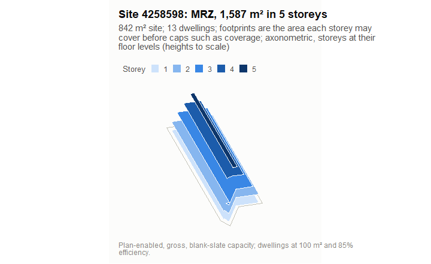
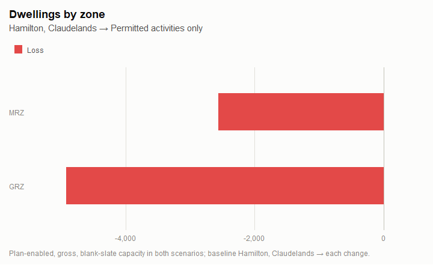

# Adding a new jurisdiction: Hamilton

This vignette adds a real jurisdiction from nothing: Hamilton, New
Zealand. It follows the route a planner or analyst would take with a
plan they have not modelled before: read the plan, enter its rules in
the Excel template, prepare the parcels and the zoning, run capacity,
check it, and ask a question of it. Everything here was done once, on 23
November 2026, with the plan as it then stood.

## 1. Read the plan

Hamilton’s rules are in the **Hamilton City Operative District Plan**,
read in its online ePlan at the revision of 13 November 2026. Plan
Change 12 (Enabling Housing Supply), Hamilton’s response to the National
Policy Statement on Urban Development, was made operative on 20 December
2024 and is part of that text. The walkthrough covers the zones of one
area, Claudelands and Hamilton East: General, Medium Density and High
Density Residential (Chapter 4), and the Business 6 (neighbourhood
centre) and Business 2 zones (Chapter 6).

For each zone, the rules that shape a building or count its dwellings
were written down with their rule numbers (the notes are in
`data-raw/hamilton/rules_notes.md` in the package source). In summary:

|  | General Residential | Medium Density Residential | High Density Residential | Business 6 |
|----|----|----|----|----|
| Height | 10 m (4.2.5.4) | 18 m, 5 storeys (4.3.4.4) | 26 m (4.4.5.4) | 11 m next to General Residential, 18 m next to Medium Density (6.4.1) |
| Recession plane | 45° from 4 m, not to a road (4.2.5.5) | one or two units: 60° from 4 m, 45° to General Residential; three or more attached units: no plane on side boundaries within 20 m of the road, 60° from 6 m beyond (4.3.4.5) | only to other zones: 45° to General Residential, 60° from 6 m to Medium Density beyond 20 m (4.4.5.5) | 45° from 4 m to General Residential, 60° to Medium Density (6.4.2) |
| Setbacks | road 1.5 m, side and rear 1.5 m (4.2.5.6) | road 1.5 m, side and rear 1 m (4.3.4.6) | 1 m; parts over 11 m 4 m back (4.4.5.6, 4.4.5.14) | 0 m front; 1.5 m to a residential zone (6.4.3) |
| Coverage | 45% (4.2.5.2) | 50% (4.3.4.2) | 60% (4.4.5.2) | floor area ratio 2:1 or 3:1 (6.4.4) |
| Landscaping | 20% (4.2.5.3) | 20% (4.3.4.3) | 10% (4.4.5.3) | none at ground floor dwellings: none allowed (6.4.7) |
| Dwellings | two per site permitted, more restricted discretionary (4.2.3.1) | three per site permitted, more restricted discretionary (4.3.3.1) | three or more restricted discretionary (4.4.3.1) | above ground floor only (6.3, 6.4.7) |

Some rules have no layer to apply them to here (the 5 m setback from
arterial roads needs the road hierarchy; a density rule applies only
inside an infrastructure overlay; a riverbank hazard setback). They are
not dropped: they go in the rulebook’s register of rules not modelled,
with the direction each would move capacity.

## 2. Enter the rules in the template

[`rulebook_template()`](https://faceteconomics.github.io/plancap/reference/rulebook_template.md)
writes an empty workbook with one sheet per kind of rule and a `fields`
sheet explaining every column. The rules above were typed into it, a row
per zone, a row per setback, each with its citation:

``` r

f <- system.file("extdata", "hamilton_rulebook.xlsx", package = "plancap")
if (!nzchar(f)) f <- "../inst/extdata/hamilton_rulebook.xlsx"
z <- openxlsx2::read_xlsx(f, sheet = "zones")
z[z$method != "none", c("zone", "codes", "height", "storeys", "coverage_max", "landscaping_min", "far_max", "height_source")]
#>   zone                                   codes height storeys coverage_max
#> 2  GRZ                     General Residential     10      NA         0.45
#> 3  MRZ              Medium Density Residential     18       5         0.50
#> 4  HDZ                High Density Residential     26      NA         0.60
#> 5  B6G        Business 6 (General Residential)     11      NA           NA
#> 6  B6M Business 6 (Medium Density Residential)     18      NA           NA
#> 7   B2                              Business 2     16      NA           NA
#>   landscaping_min far_max     height_source
#> 2             0.2      NA   HCC ODP 4.2.5.4
#> 3             0.2      NA HCC ODP 4.3.4.4 a
#> 4             0.1      NA   HCC ODP 4.4.5.4
#> 5              NA       2     HCC ODP 6.4.1
#> 6              NA       3     HCC ODP 6.4.1
#> 7              NA       2     HCC ODP 6.4.1
s <- openxlsx2::read_xlsx(f, sheet = "setbacks")
s[s$target == "MRZ", c("target", "kind", "boundaries", "distance", "angle_deg", "start_height", "above_height",
                       "within_frontage", "beyond_frontage", "adjacent_zones", "not_adjacent_zones", "variant")]
#>    target        kind boundaries distance angle_deg start_height above_height
#> 6     MRZ        yard       road      1.5        NA           NA           NA
#> 7     MRZ        yard       side      1.0        NA           NA           NA
#> 8     MRZ        yard       rear      1.0        NA           NA           NA
#> 9     MRZ       plane side, rear       NA        60            4           NA
#> 10    MRZ       plane side, rear       NA        45            4           NA
#> 11    MRZ upper_level       side      4.0        NA           NA           11
#> 12    MRZ       plane side, rear       NA        60            6           NA
#> 13    MRZ       plane side, rear       NA        45            4           NA
#>    within_frontage beyond_frontage adjacent_zones not_adjacent_zones
#> 6               NA              NA           <NA>               <NA>
#> 7               NA              NA           <NA>               <NA>
#> 8               NA              NA           <NA>               <NA>
#> 9               NA              NA           <NA>                GRZ
#> 10              NA              NA            GRZ               <NA>
#> 11              20              NA           <NA>                GRZ
#> 12              NA              20           <NA>                GRZ
#> 13              NA              NA            GRZ               <NA>
#>          variant
#> 6           <NA>
#> 7           <NA>
#> 8           <NA>
#> 9  single_duplex
#> 10 single_duplex
#> 11      attached
#> 12      attached
#> 13      attached
```

Medium Density’s two sets of standards (one or two units; three or more
attached) are entered as two **variants**: each site is built under both
and takes the one that enables more. Business 6’s residential share is a
band by storey, none on the ground floor:

``` r

openxlsx2::read_xlsx(f, sheet = "bands")
#>   target              rule     by upper value
#> 2    B6G residential_share storey     1     0
#> 3    B6G residential_share storey    NA     1
#> 4    B6M residential_share storey     1     0
#> 5    B6M residential_share storey    NA     1
#>                                                     source
#> 2 HCC ODP 6.4.7 b: no residential activity at ground floor
#> 3                                                     <NA>
#> 4 HCC ODP 6.4.7 b: no residential activity at ground floor
#> 5                                                     <NA>
```

The workbook reads back as a rulebook, checked against the schema and
for missing citations:

``` r

rb <- read_rulebook(f)
rb
#> <plancap rulebook> Hamilton City Operative District Plan (residential zones and
#> Business 6, walkthrough extract)
#> hamilton-odp-2026 | Hamilton | NZ | as at 2026-11-13
#> 11 zones, 0 overlays, 0 areas, 0 bonuses, 0 entitlements; 7 unmodelled rules.
#> Units: metres.
#>  zone label                                                           
#>  GRZ  General Residential Zone                                        
#>  MRZ  Medium Density Residential Zone                                 
#>  HDZ  High Density Residential Zone                                   
#>  B6G  Business 6 Zone, adjacent to the General Residential Zone       
#>  B6M  Business 6 Zone, adjacent to the Medium Density Residential Zone
#>  B2   Business 2 Zone (Events Facilities Fringe)                      
#>  CFZ  Community Facilities Zone                                       
#>  MFZ  Major Facilities Zone                                           
#>  OSZ  Open Space Zones                                                
#>  INZ  Industrial Zone                                                 
#>  TCZ  Transport Corridor Zone                                         
#>  method     height setbacks coverage codes                                  
#>  volumetric 10     4        0.45     General Residential                    
#>  volumetric 18     8        0.5      Medium Density Residential             
#>  volumetric 26     7        0.6      High Density Residential               
#>  volumetric 11     3                 Business 6 (General Residential)       
#>  volumetric 18     3                 Business 6 (Medium Density Residential)
#>  volumetric 16     3                 Business 2                             
#>  none              0                 Community Facilities                   
#>  none              0                 Major Facilities                       
#>  none              0                 Open Space                             
#>  none              0                 Industrial                             
#>  none              0                 Transport Corridor
validate_rulebook(rb)
#> ✔ Rulebook is valid (0 warnings, 0 notes).
head(rule_table(rb)[, c("zone", "rule", "value", "applies_to", "source")], 12)
#>    zone                             rule             value applies_to
#> 1   GRZ                           method        volumetric       <NA>
#> 2   GRZ                           height 10; occupiable 10       <NA>
#> 3   GRZ                     setback:yard             1.5 m       road
#> 4   GRZ                     setback:yard             1.5 m       side
#> 5   GRZ                     setback:yard             1.5 m       rear
#> 6   GRZ                    setback:plane   45 deg from 4 m side, rear
#> 7   GRZ                     coverage_max              0.45       <NA>
#> 8   GRZ                  landscaping_min               0.2       <NA>
#> 9   GRZ                   impervious_max               0.7       <NA>
#> 10  GRZ density.minor_dwellings_per_site                 1       <NA>
#> 11  GRZ                  use.residential              TRUE       <NA>
#> 12  GRZ                     use.business             FALSE       <NA>
#>                                                                source
#> 1                                HCC ODP 4.2 General Residential Zone
#> 2                                                     HCC ODP 4.2.5.4
#> 3          HCC ODP 4.2.5.6 a: local and collector transport corridors
#> 4                                                   HCC ODP 4.2.5.6 b
#> 5                                                   HCC ODP 4.2.5.6 d
#> 6  HCC ODP 4.2.5.5: 45 degrees from 4 m, all boundaries except a road
#> 7                                                     HCC ODP 4.2.5.2
#> 8                                                   HCC ODP 4.2.5.3 b
#> 9                                                   HCC ODP 4.2.5.3 a
#> 10 HCC ODP 4.2.3.1, 4.2.6.1: ancillary residential unit, one per site
#> 11                                                    HCC ODP 4.2.3.1
#> 12                                                    HCC ODP 4.2.3.1
```

## 3. Prepare the parcels and zoning

Two layers come from their publishers, cut to a square of about 1.4 km
over Claudelands and Hamilton East:

- **parcels**: LINZ NZ Primary Parcels (CC BY 4.0), split into land
  parcels and road parcels;
- **zoning**: Hamilton City Council’s District Plan Zones. The council
  asks that its data be attributed to it and that derived work say it is
  not the authoritative source: this is derived work, not Hamilton City
  Council’s data. The zoning is not shipped with the package.

The zoning layer needs three changes before plancap can use it, which is
typical of a council layer (`data-raw/hamilton/prepare.R`):

1.  Zone names become the codes the rulebook’s zone map expects (`codes`
    in the zones sheet).
2.  Business 6’s height and floor area ratio depend on the residential
    zone it adjoins, so each centre polygon is coded by its neighbour.
3.  Two features are not zones: the Industrial Amenity Protection Area
    (an overlay stored with the zones) and the Transport Corridor Zone.

The third was found the useful way. The first run left the Transport
Corridor Zone in, and
[`check_capacity()`](https://faceteconomics.github.io/plancap/reference/check_capacity.md)
failed its land check: the sites added to twice the land in the parcels.
That zone is a single polygon under every other zone, so it split nearly
every parcel in two. Roads come from the road parcels, so the polygon is
dropped.

``` r

source("../data-raw/hamilton/prepare.R")
h <- hamilton_inputs("../data-raw/cache/hamilton")
table(h$zoning$zone)
#> 
#>                              Business 2        Business 6 (General Residential) 
#>                                       2                                       2 
#> Business 6 (Medium Density Residential)                    Community Facilities 
#>                                       2                                       6 
#>                     General Residential                High Density Residential 
#>                                      50                                       5 
#>                        Major Facilities              Medium Density Residential 
#>                                       1                                      13 
#>                              Open Space 
#>                                      23
nrow(h$parcels)
#> [1] 1474
```

## 4. Run capacity and check it

``` r

sc <- scenario("Hamilton, Claudelands", rb, parcels = h$parcels, roads = h$roads, zoning = h$zoning)
cap <- estimate_capacity(sc)
summary(cap)
#> 
#> ── Capacity: Hamilton, Claudelands ──
#> 
#> 1,493 sites on 187.5 ha: 1,639,304 m2 of floor area (1,580,456 m2 residential,
#> 58,847 m2 business), 12,829 dwellings and 0 minor dwellings.
#> Plan-enabled, gross, blank-slate capacity; dwellings at 100 m2 and 85%
#> efficiency.
#> 
#> ── By zone
#>  zone_key sites land_area floor_area dwellings  far floor_area_share
#>    (none)   121    87,120          0         0 0.00             0.0%
#>        B2    20    23,245     46,491         0 2.00             2.8%
#>       B6G    18    10,256     20,513        80 2.00             1.3%
#>       B6M    12     2,591      7,387        37 2.85             0.5%
#>       CFZ    35   305,192          0         0 0.00             0.0%
#>       GRZ   970   721,053    848,576     6,732 1.18            51.8%
#>       HDZ    91    86,529    355,024     2,980 4.10            21.7%
#>       MFZ     2   163,624          0         0 0.00             0.0%
#>       MRZ   162   160,558    361,314     3,000 2.25            22.0%
#>       OSZ    62   314,655          0         0 0.00             0.0%
#> 
#> ── Flags
#> no_capacity 54, no_capacity_zone 99, no_zone 121, ok 1,219
#> 
#> ── What limits dwellings
#> floor_area 1,273
check_capacity(cap)
#> ✔ parcels accounted for: 1474 of 1474 (every input parcel is in a site)
#> ✔ land in equals land out: 1874825 of 1874825 m2 (site areas add to parcel areas (overlaps aside))
#> ✔ storeys add to sites: 1639304 m2 (floor area by storey equals floor area by site)
#> ✔ uses add to floor area:  (residential plus business equals floor area)
#> ✔ no missing or negative values: 0 (floor area and dwellings)
#> ✔ within the height's storeys: 0 (no site above its area times its storeys)
#> ✔ site ids unique: 0
#> ✔ dwellings need floor area: 0 (volumetric sites with dwellings but no floor area)
#> ✔ access measured: 0 (sites the access width table could not be applied to)
#> ✔ flags: no_capacity 54, no_capacity_zone 99, no_zone 121, ok 1219 (sites by flag)
#> ✔ sites with no capacity: 274 (no_zone 121, no_capacity_zone 99, no_capacity 54)
```

The 121 sites with no zone are land parcels inside the transport
corridor (once the corridor polygon is dropped, nothing zones them).
They are flagged, not dropped.

``` r

plot_capacity(cap)
```


plot of chunk unnamed-chunk-7

``` r

plot_capacity(cap, measure = "dwellings", fill = "height_band")
```


plot of chunk unnamed-chunk-7

``` r

plot_constraints(cap)
```


plot of chunk unnamed-chunk-7

``` r

plot_capacity_map(cap, grid = 100)
```


plot of chunk unnamed-chunk-7

## 5. Look at one site

A Medium Density site near a General Residential boundary shows the
alternative standards at work:

``` r

s <- sf::st_drop_geometry(cap$sites)
pick <- s$site_id[s$zone_key %in% "MRZ" & s$area > 600 & s$area < 900][1]
ex <- explain_site(cap, pick)
ex$site[, c("site_id", "zone_key", "area", "variant", "storeys", "floor_area", "dwellings")]
#>    site_id zone_key     area  variant storeys floor_area dwellings
#> 13 4258598      MRZ 841.9517 attached       5   1586.505        13
ex$setbacks[ex$setbacks$storey == 5, c("segment_id", "boundary_class", "setback", "rule", "source")]
#>    segment_id boundary_class  setback        rule
#> 25  4258598-1           road 1.500000        yard
#> 26  4258598-2           side 6.928203       plane
#> 27  4258598-3           side 4.000000 upper_level
#> 28  4258598-4           side 4.000000 upper_level
#> 29  4258598-5           road 1.500000        yard
#> 30  4258598-6           side 6.928203       plane
#>                                                                                           source
#> 25                                                                          HCC ODP 4.3.4.6 a ii
#> 26             HCC ODP 4.3.4.5 b, Figure 4.3.4.5 b: beyond 20 m of the road, 60 degrees from 6 m
#> 27 HCC ODP 4.3.4.5 b: within 20 m of the road, parts over 11 m set back 4 m from side boundaries
#> 28 HCC ODP 4.3.4.5 b: within 20 m of the road, parts over 11 m set back 4 m from side boundaries
#> 29                                                                          HCC ODP 4.3.4.6 a ii
#> 30             HCC ODP 4.3.4.5 b, Figure 4.3.4.5 b: beyond 20 m of the road, 60 degrees from 6 m
plot_site(cap, pick, view = "axo")
```



plot of chunk unnamed-chunk-8

## 6. Ask a question: permitted activities only

Capacity here counts restricted discretionary development where the
plan’s standards bound it, as plancap’s Auckland example does. A
narrower reading counts only what is permitted: two units per site in
General Residential and three in Medium Density. That is a rule change,
so it is a scenario:

``` r

permitted <- rb |>
  set_rule("zones.GRZ.density.max_dwellings_per_site", 2) |>
  set_rule("zones.MRZ.density.max_dwellings_per_site", 3)
sc_p <- scenario_change(sc, "Permitted activities only", rulebook = permitted)
cmp <- compare_scenarios(run_scenarios(scenario_set(sc, sc_p)))
#> Hamilton, Claudelands: 4.4 s.
#> Permitted activities only: 3.3 s, 240 sites copied from the baseline.
cmp$pairs[[1]]$totals
#>                  measure baseline scenario change change_pct
#> 1             floor_area  1639304  1639304      0    0.00000
#> 2 residential_floor_area  1580456  1580456      0    0.00000
#> 3              dwellings    12829     5344  -7485  -58.34438
plot_comparison(cmp, measure = "dwellings", type = "bars")
```



plot of chunk unnamed-chunk-9

Floor area does not move (the envelopes are the same); dwellings fall to
the permitted count wherever the envelope holds more.

## 7. What is not modelled

``` r

unmodelled_report(rb)[, c("rule", "likely_effect")]
#>                                                                                    rule
#> 1                                             Arterial transport corridor setback (5 m)
#> 2                       Density within the Three Waters Infrastructure Capacity Overlay
#> 3      Separation between residential buildings on a site; upper-floor balcony setbacks
#> 4 Outlook space, outdoor living area, front landscaping, tree canopy, wall articulation
#> 5                                 Waikato Riverbank and Gully Hazard Area setback (6 m)
#> 6 Maximum average net site area (MRZ, HDZ) and minimum residential density (Business 6)
#> 7           Building coverage of 60% for terraces and apartments with rear-lane parking
#>   likely_effect
#> 1    overstates
#> 2    overstates
#> 3    overstates
#> 4    overstates
#> 5    overstates
#> 6        either
#> 7   understates
```

## A checklist for a new jurisdiction

1.  Read the plan for each zone you need: height (and storeys),
    recession planes, setbacks by boundary, coverage, landscaping and
    impervious area, floor area ratio, density, the dwellings each
    activity status allows, and any alternative standards. Note every
    rule number.
2.  Write a blank template with
    [`rulebook_template()`](https://faceteconomics.github.io/plancap/reference/rulebook_template.md),
    fill the `plan`, `zones`, `setbacks` and `bands` sheets, and the
    register of rules not modelled. Read it with
    [`read_rulebook()`](https://faceteconomics.github.io/plancap/reference/read_rulebook.md);
    fix what
    [`validate_rulebook()`](https://faceteconomics.github.io/plancap/reference/validate_rulebook.md)
    reports.
3.  Get parcels (LINZ in New Zealand) and the council’s zoning. Map zone
    names to the rulebook’s codes; take overlays and non-zones out of
    the zone layer.
4.  Run
    [`estimate_capacity()`](https://faceteconomics.github.io/plancap/reference/estimate_capacity.md)
    and
    [`check_capacity()`](https://faceteconomics.github.io/plancap/reference/check_capacity.md).
    A land check that fails means overlapping zones or parcels.
5.  Look at a few sites with
    [`explain_site()`](https://faceteconomics.github.io/plancap/reference/explain_site.md)
    and
    [`plot_site()`](https://faceteconomics.github.io/plancap/reference/plot_site.md)
    before trusting totals.
6.  Put the rulebook
    ([`write_rulebook()`](https://faceteconomics.github.io/plancap/reference/read_rulebook.md))
    and the preparation script under version control, so the run can be
    repeated when the plan changes.
