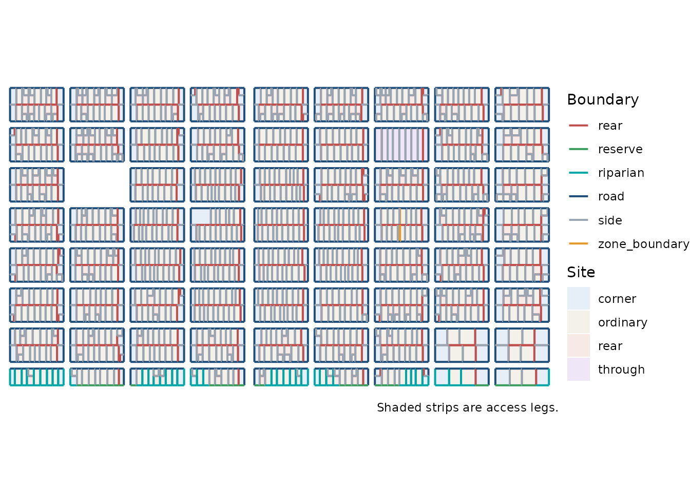

# Preparing sites

Before any rule applies, plancap has to know what each parcel is: which
of its boundaries front a road and which are side or rear boundaries,
whether it is a corner, through or rear site, whether it has an access
leg, what zone lies across each boundary, and how far it is from
features rules refer to. This is **site preparation**, and most
surprises in a capacity run start here, so it is worth checking.

``` r

library(plancap)
#> 
#> Attaching package: 'plancap'
#> The following object is masked from 'package:stats':
#> 
#>     density
town <- exampleton()
land <- town$parcels[town$parcels$parcel_type == "land", ]
roads <- town$parcels[town$parcels$parcel_type == "road", ]
```

## Two steps, each reused

[`prepare_sites()`](https://faceteconomics.github.io/plancap/reference/prepare_sites.md)
works in two steps, each stored under a hash of its inputs:

1.  **Parcel geometry** depends only on parcels, roads, water, road
    centre lines and the ground: boundary segments and their classes,
    frontage, corner, through and rear sites, access legs and their
    widths, road widths, ground levels.
2.  **Plan geometry** adds the zoning, overlays and areas: sites split
    where zones cross them, the zone across each boundary, overlay and
    area membership, distances to features.

A scenario that changes only rule values reuses both; one that changes
the zoning reuses the first.

``` r

sc <- scenario("Operative", rulebook_example("exampleton"), parcels = land, roads = roads,
               zoning = town$zoning, water = town$water, centrelines = town$road_centrelines)
s <- prepare_sites(sc)
s
#> <plancap sites> Operative: 1379 sites, 5912 boundary segments.
#> Zones: MDR 714, HDR 272, MU 176, LDR 108, TC 85, IND 24.
#> Corner 295, through 9, rear 144 (142 with access legs); split by zone 2.
#> ! adjacency_unresolved: 173
#> ! overlay_layers_missing: height_areas, flood_hazard, heritage, trees
#> ! area_layers_missing: precincts
#> ! distance_layers_missing: transit
table(s$segments$boundary_class)
#> 
#> rear road side 
#> 1397 1683 2832
```

## Classifying boundaries

A boundary segment is a **road** boundary when at least half of it runs
along a road parcel. The rest are **side** or **rear**: a segment is
rear when it is within 30 degrees of parallel to the frontage and lies
at least half the site’s depth back from it. Tags add what a rule may
care about: `reserve` (open space across the boundary), `riparian`,
`coastal`, `lakeside` (near water), `zone_boundary`. Where a plan says a
rear site’s yards are all rear yards (as the Auckland Unitary Plan
does), the morphology setting `rear_site_sides_as_rear` makes its side
boundaries rear ones.

The `find_*()` helpers return each classification with its evidence:

``` r

fr <- find_road_frontages(land[1:200, ], roads)
head(fr[, c("site_id", "segment_id", "boundary_class", "length", "road_shared_length")])
#> Simple feature collection with 6 features and 5 fields
#> Geometry type: LINESTRING
#> Dimension:     XY
#> Bounding box:  xmin: 2200020 ymin: 5600040 xmax: 2200091 ymax: 5600090
#> Projected CRS: NZGD2000 / New Zealand Transverse Mercator 2000
#>    site_id segment_id boundary_class   length road_shared_length
#> 1  S000001  S000001-1           road 50.00000           50.00000
#> 2  S000001  S000001-2           road 14.28599           14.28599
#> 6  S000002  S000002-2           road 20.52427           20.52427
#> 10 S000003  S000003-2           road 15.56643           15.56643
#> 14 S000004  S000004-2           road 16.77586           16.77586
#> 18 S000005  S000005-2           road  4.00000            4.00000
#>                          geometry
#> 1  LINESTRING (2200020 5600040...
#> 2  LINESTRING (2200020 5600090...
#> 6  LINESTRING (2200034 5600090...
#> 10 LINESTRING (2200055 5600090...
#> 14 LINESTRING (2200074 5600090...
#> 18 LINESTRING (2200070 5600090...
corner <- find_corner_sites(land, roads)
table(corner$is_corner)
#> 
#> FALSE  TRUE 
#>  1082   295
rear <- find_rear_sites(land, roads)
table(rear$is_rear)
#> 
#> FALSE  TRUE 
#>  1235   142
```

[`check_morphology()`](https://faceteconomics.github.io/plancap/reference/check_morphology.md)
compares the shares with the ranges usually seen, and
[`plot_morphology()`](https://faceteconomics.github.io/plancap/reference/check_morphology.md)
draws them:

``` r

check_morphology(s)
#> Morphology check: 0 measures outside the usual range.
#>  measure                               value usual   status
#>  sites with no road frontage           0.0%  0-5%    ok    
#>  corner sites                          21.4% 2-25%   ok    
#>  through sites                         0.7%  0-5%    ok    
#>  rear sites                            10.4% 0-30%   ok    
#>  rear sites with an access leg         98.6% 30-100% ok    
#>  boundary length that is road frontage 19.7% 15-45%  ok    
#>  boundary length that is rear          18.5% 10-35%  ok    
#>  boundaries with no zone across        2.9%  0-5%    ok    
#>  sites with no zone                    0.0%  0-1%    ok    
#>  sites split by a zone boundary        0.1%  0-5%    ok
```

``` r

plot_morphology(s)
```



## Every assumption can be changed

The thresholds behind these calls are settings, with defaults
([`morphology_defaults()`](https://faceteconomics.github.io/plancap/reference/morphology_defaults.md)),
overridable in the rulebook
([`set_morphology()`](https://faceteconomics.github.io/plancap/reference/set_rules.md))
or for one run (`scenario(morphology = )`):

``` r

str(morphology_defaults()[c("road_tolerance", "rear_site_max_frontage", "side_rear_angle_tolerance",
                             "rear_depth_share", "access_leg_max_width")])
#> List of 5
#>  $ road_tolerance           : num 0.5
#>  $ rear_site_max_frontage   : num 7.5
#>  $ side_rear_angle_tolerance: num 30
#>  $ rear_depth_share         : num 0.5
#>  $ access_leg_max_width     : num 7.5
narrow <- scenario_change(sc, "Wider access legs", morphology = list(access_leg_max_width = 9))
sum(prepare_sites(narrow)$sites$access_leg_area > 0)
#> [1] 142
sum(s$sites$access_leg_area > 0)
#> [1] 142
```

## Access to rear sites

A rear site (less road frontage than `rear_site_max_frontage`, 7.5 m) is
reached by its own entrance strip, a right of way over a neighbour, or a
jointly owned access lot.
[`find_access_widths()`](https://faceteconomics.github.io/plancap/reference/find_access_widths.md)
measures all three, given easement areas (`scenario(easements = )`) and
the other parcels (`scenario(other_parcels = )`). A site where nothing
is found has unknown access, not none: the access width table does not
apply and the site is flagged.

## Zones across boundaries

Rules often depend on the zone next door (a plane against a lower
density zone). The zone across each boundary is found by probing outward
from its middle: one metre across a side or rear boundary, across the
carriageway for a road boundary.

``` r

head(sf::st_drop_geometry(s$segments)[, c("segment_id", "boundary_class", "adjacent_zone_key")])
#>   segment_id boundary_class adjacent_zone_key
#> 1   P00001-1           road              <NA>
#> 2   P00001-2           road               MDR
#> 3   P00001-3           rear               MDR
#> 4   P00001-4           side                OS
#> 5   P00002-1           side               MDR
#> 6   P00002-2           road               MDR
```

## Ground levels

Give a DEM (`scenario(dem = )`) or ground level tables
(`scenario(ground = )`) for terrain. Each site’s ground is a plane
fitted to the ground along its boundaries; planes are measured from the
ground at their own boundary. `defaults$terrain = "flat"` stands every
building on one floor at the site’s mean ground instead.

## Pitfalls

- **Overlapping zone polygons** split parcels twice;
  [`check_capacity()`](https://faceteconomics.github.io/plancap/reference/check_capacity.md)
  reports it as land out exceeding land in. A council layer may hold
  overlays or a background polygon among its zones (Hamilton’s Transport
  Corridor Zone covers the whole city): take them out.
- **Roads missing from the parcels** leave every boundary a side
  boundary: check the road share in
  [`check_morphology()`](https://faceteconomics.github.io/plancap/reference/check_morphology.md).
- **Parcels held together** (a site on several titles) can be dissolved
  into one site with `scenario(group_by = )`; pieces of one landholding
  kept apart share their access with `scenario(landholding = )`.
